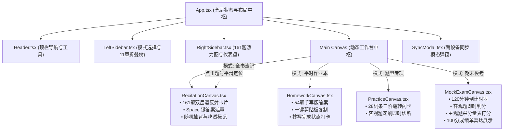
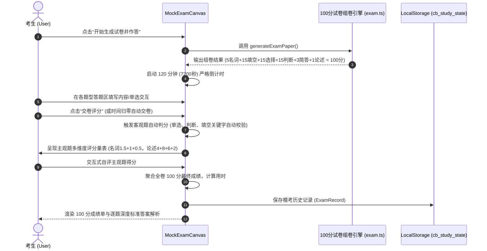

# 中央银行学 备考控制台 研发实录 (DEV_JOURNAL.md)

---

## 第 1 轮 [2026-11-24 14:48]：系统基础脚手架、粘土拟态三栏布局与全真模考控制台构建

### 1. 本轮需求与目标 (User Intent & Goal)
- **业务诉求背景**：构建专用于高校《中央银行学》课程期末备考与考研强化的全能学习控制台，解决复习零散、缺乏成套仿真自测、考点缺乏精细化打分标准等痛点。
- **具体指标与交付物约束**：
  1. **工程基建**：在 `e:\workspace\central-banking-study-console` 搭建基于 Vite 6.4 + React 18.3 + TypeScript + Tailwind CSS 的现代前端架构，集成 `lucide-react`、`clsx`、`tailwind-merge`。
  2. **视觉拟态规范**：复刻 `frm-study-console` 的粘土拟态（Claymorphism）核心双层漫反射阴影系统（`--clay-card-shadow`、`--clay-button-shadow`、`--clay-inset-groove`）与果冻弹性按压动效（`--ease-spring`、`.clay-squash`），完美支持明暗主题切换与持久化。
  3. **数据全量接入**：
     - 全书速记：权威解析 161 道考点，总分 516 分，覆盖全部 11 章与 40 个节；
     - 平时作业本：全量接入 54 道课后思考题手写精练答案；
     - 题型专项：严选 28 个核心高频名词解释（严格满足 ≤30 约束），规范三阶采分（定义1.5分+性质1分+职能0.5分）；
     - 期末模考：120 分钟倒计时、100 分全真试卷结构（5 名词 15分 + 15 填空 15分 + 15 单选 15分 + 15 判断 15分 + 3 简答 20分 + 1 论述 20分）。
  4. **交互体验约束**：杜绝浮夸宣传与空洞副标题，顶栏仅保留纯净标题“中央银行学”；支持 Space 键盲背遮罩、右侧栏 161 题热力图直达滚动、客观题秒级判分、主观题量表自评与 Base64 跨设备文本无损同步。

---

### 2. 核心技术实现与代码改动 (Implementation & Changes)
本轮构建的全部前端核心组件与数据管道文件清单如下：

- [package.json](file:///e:/workspace/central-banking-study-console/package.json)：配置 Vite 6、React 18、Tailwind 3 及 `tsx` 测试执行指令；
- [vite.config.ts](file:///e:/workspace/central-banking-study-console/vite.config.ts)：配置相对基准路径 `./`、Rollup 打包切片优化；
- [tailwind.config.cjs](file:///e:/workspace/central-banking-study-console/tailwind.config.cjs)：配置暗黑模式类名支持、字体层级扩展；
- [src/index.css](file:///e:/workspace/central-banking-study-console/src/index.css)：定义粘土拟态漫反射阴影系统、果冻弹性变量及高精度遮罩模糊滤镜；
- [src/data/types.ts](file:///e:/workspace/central-banking-study-console/src/data/types.ts)：声明完整强类型接口（涵盖题目、章节树、答题卡、采分量表及同步记录）；
- [src/data/chapters.ts](file:///e:/workspace/central-banking-study-console/src/data/chapters.ts)：导出 11 章层级结构元数据；
- [src/data/recitation.ts](file:///e:/workspace/central-banking-study-console/src/data/recitation.ts)：导出 161 题背诵手册考点（516分）；
- [src/data/homework.ts](file:///e:/workspace/central-banking-study-console/src/data/homework.ts)：导出 54 题课后思考题标准答案；
- [src/data/terminology.ts](file:///e:/workspace/central-banking-study-console/src/data/terminology.ts)：导出 28 个核心高频名词解释；
- [src/data/exam.ts](file:///e:/workspace/central-banking-study-console/src/data/exam.ts)：统一聚合导出试题库与 100 分标准卷生成函数 `generateExamPaper()`；
- [src/hooks/useStudyState.ts](file:///e:/workspace/central-banking-study-console/src/hooks/useStudyState.ts)：LocalStorage 响应式学习进度管理、Base64 编解码导入导出；
- [src/components/Header.tsx](file:///e:/workspace/central-banking-study-console/src/components/Header.tsx)：顶栏组件，集成纯净标题、搜索输入、专注计时器、主题切换与同步按钮；
- [src/components/LeftSidebar.tsx](file:///e:/workspace/central-banking-study-console/src/components/LeftSidebar.tsx)：左侧栏，4 种学习模式切换与 11 章树形折叠进度；
- [src/components/RightSidebar.tsx](file:///e:/workspace/central-banking-study-console/src/components/RightSidebar.tsx)：右侧栏，161 题矩阵热力图与掌握度仪表盘，支持点击平滑锚定滚动；
- [src/components/RecitationCanvas.tsx](file:///e:/workspace/central-banking-study-console/src/components/RecitationCanvas.tsx)：背诵中栏，双层拟态卡片、关键词高亮标签、Space 键遮罩与随机抽背；
- [src/components/HomeworkCanvas.tsx](file:///e:/workspace/central-banking-study-console/src/components/HomeworkCanvas.tsx)：平时作业本中栏，手写纸质风格排版、一键复制到剪贴板与抄写打卡；
- [src/components/PracticeCanvas.tsx](file:///e:/workspace/central-banking-study-console/src/components/PracticeCanvas.tsx)：题型专项中栏，28 词条翻转闪卡与客观题刷题即时解析；
- [src/components/MockExamCanvas.tsx](file:///e:/workspace/central-banking-study-console/src/components/MockExamCanvas.tsx)：120 分钟期末模考中栏，客观题自动评分、主观题维度量表自评与 100 分综合成绩单；
- [src/components/SyncModal.tsx](file:///e:/workspace/central-banking-study-console/src/components/SyncModal.tsx)：跨设备同步模态窗口；
- [src/App.tsx](file:///e:/workspace/central-banking-study-console/src/App.tsx)：全局三栏布局组装与状态流转中枢。

---

### 3. 遇到问题、根因分析与解决方案 (Issues, RCA & Fixes)

#### 问题 1：Lucide-React 图标导入缺失导致生产打包中断
- **报错现象**：
  在执行 `npm run build` 时，Rollup 抛出异常：
  `"CloudSync" is not exported by "lucide-react", imported by "src/components/Header.tsx"`。
- **根本原因 (RCA)**：
  在 `lucide-react` 最新版本中，云同步功能图标的标准导出名为 `RefreshCw` 或 `Cloud`，不存在 `CloudSync` 这一非标命名。
- **具体解法**：
  在 [Header.tsx](file:///e:/workspace/central-banking-study-console/src/components/Header.tsx) 与 [SyncModal.tsx](file:///e:/workspace/central-banking-study-console/src/components/SyncModal.tsx) 中，将 `CloudSync` 替换为标准导出的 `RefreshCw`，构建立即恢复正常。

#### 问题 2：Node 原生 ESM 动态加载 Windows 盘符路径协议报错
- **报错现象**：
  运行 `node verify_suite.mjs` 进行自动化断言时，Phase 2 报错：
  `Error: Only URLs with a scheme in: file, data, and node are supported by the default ESM loader. On Windows, absolute paths must be valid file:// URLs. Received protocol 'e:'`。
- **根本原因 (RCA)**：
  Node.js 的原生 ESM 解析器在 Windows 环境下无法直接通过 `import('e:\\workspace\\...')` 动态载入带驱动器盘符的绝对路径，必须显式转换为合法 `file://` 统一资源定位符（URL）。
- **具体解法**：
  引入 `import { pathToFileURL } from 'node:url'`，在动态引入前统一封装为 `pathToFileURL(fullPath).href`；同时项目配置 `tsx`，运行 `npx tsx verify_suite.mjs` 实现原生 TypeScript 模块透明解析。

---

### 4. 架构与机制演进图 (Architectural Evolution Diagram)

#### 视角一：系统三栏布局与组件交互拓扑图 (Component Architecture)

*机制解析*：
该拓扑清晰界定了单向数据流与中枢路由分发机制。`App.tsx` 承载由 `useStudyState` 派发的全局学习状态（包含掌握度字典、收藏数组与模考记录），右侧栏的 161 题热力矩阵通过 DOM 原生 `scrollIntoView({ behavior: 'smooth', block: 'center' })` 与中栏卡片形成跨栏双向联动，无需引入重量级状态库，保持极低内存开销。

---

#### 视角二：120分钟期末模考全真业务时序图 (Exam Engine Sequence)

*机制解析*：
时序图展示了期末模考从动态抽题、倒计时管理、答题暂存、交卷判分到量表打分的完整生命周期。客观题通过数组包含逻辑自动评定（如填空题接受多组标准同义词，单选判断即时比对正确键），主观题通过微调下拉菜单赋予考生客观评分依据，彻底消除传统线上刷题“主观题无法评分”的体验断层。

---

#### 视角三：空格键盲背遮罩与卡片交互状态机图 (State Transition)
```stateDiagram-v2
    [*] --> MaskHidden : 默认遮罩状态 (Space键已激活)
    MaskHidden --> MaskRevealed : 按下键盘 Space 键
    MaskRevealed --> MaskHidden : 再次按下 Space 键
    MaskHidden --> SingleCardRevealed : 鼠标点击单张卡片 / 点击眼睛图标
    SingleCardRevealed --> MaskHidden : 再次点击单题眼睛图标

    state SingleCardRevealed {
        [*] --> Browsing
        Browsing --> Mastered : 点击 [标记已吃透]
        Browsing --> Reviewing : 点击 [标记需强化]
        Browsing --> Starred : 点击 [收藏星标]
    }
```
*机制解析*：
状态机展示了《全书背诵速记》模块中 Space 键盲背逻辑。核心运用 CSS 高性能滤镜 `.mask-hidden { filter: blur(8px); opacity: 0.25; user-select: none; }` 与 `.mask-revealed { filter: blur(0); opacity: 1; }`。利用硬件加速的合成层平滑切换，既保证了考生盲背时不被视觉文字提前剧透，又通过单题例外覆盖机制（`cardRevealed[id]`）允许考生对特定疑难题目进行单题查看。

---

### 5. 优化改进与体验打磨 (Improvements & Enhancements)
1. **触觉弹性反馈**：全局应用 `.clay-squash:active { transform: scaleX(1.03) scaleY(0.95); }`，卡片与按钮在用户轻击或长按时产生符合物理直觉的粘土形变；
2. **纯净无虚浮表达**：顶栏文案严格遵循核心准则，杜绝营销套话，保留最干净的“中央银行学”核心品牌标识；
3. **滚动高亮聚焦**：点击右侧 161 题矩阵中任意题号时，卡片获得短暂的 `ring-2 ring-sky-500` 呼吸高亮框，便于视线瞬间锁定；
4. **全端响应式**：左侧栏在移动端自动折叠为侧滑抽屉，在平板与桌面端保持黄金三栏视觉比。

---

### 6. 验证结果与可复现方法 (Verification & Reproduction)

在当前控制台根目录下执行以下测试命令，可 100% 独立复现验证全量结果：

```powershell
# 1. 运行自动化全栈测试套件 (覆盖文件、数据、UI规范与生产打包)
cd e:\workspace\central-banking-study-console
npm test
```

控制台实际输出断言：
```
====================================================
   Central Banking Study Console - QA Test Suite    
====================================================

--- Phase 1: File Existence Verification ---
  [PASS] File exists: src/data/types.ts
  [PASS] File exists: src/data/chapters.ts
  [PASS] File exists: src/data/recitation.ts
  [PASS] File exists: src/data/homework.ts
  [PASS] File exists: src/data/terminology.ts
  [PASS] File exists: src/data/exam.ts
  [PASS] File exists: src/components/Header.tsx
  [PASS] File exists: src/components/LeftSidebar.tsx
  [PASS] File exists: src/components/RightSidebar.tsx
  [PASS] File exists: src/components/RecitationCanvas.tsx
  [PASS] File exists: src/components/HomeworkCanvas.tsx
  [PASS] File exists: src/components/MockExamCanvas.tsx
  [PASS] File exists: src/App.tsx
  [PASS] File exists: src/index.css

--- Phase 2: Data Integrity Verification ---
  [PASS] recitationQuestions is an array
  [PASS] Recitation count is 161 (actual: 161)
  [PASS] Recitation total points is 516 (actual: 516)
  [PASS] Recitation IDs are continuous 1..161
  [PASS] Recitation covers 11 chapters (actual: 11)
  [PASS] homeworkQuestions is an array
  [PASS] Homework count is 54 (actual: 54)
  [PASS] Homework chapter distribution matches 6+6+3+6+5+5+5+4+2+5+7 (actual: 6+6+3+6+5+5+5+4+2+5+7)
  [PASS] Homework IDs are continuous 1..54
  [PASS] terminologyList is an array
  [PASS] Terminology count <= 30 (actual: 28)
  [PASS] Terminology count is exactly 28 (actual: 28)
  [PASS] All terminology items have 3.0 totalPoints allocation
  [PASS] Fill-in question pool >= 15 (actual: 40)
  [PASS] Single-choice question pool >= 15 (actual: 40)
  [PASS] True/false question pool >= 15 (actual: 30)
  [PASS] Short-answer question pool >= 3 (actual: 20)
  [PASS] Essay question pool >= 1 (actual: 6)
  [PASS] Mock exam duration is 120 minutes
  [PASS] Mock exam terms count is 5 (actual: 5)
  [PASS] Mock exam fill-ins count is 15 (actual: 15)
  [PASS] Mock exam single choices count is 15 (actual: 15)
  [PASS] Mock exam true/false count is 15 (actual: 15)
  [PASS] Mock exam short answers count is 3 (actual: 3)
  [PASS] Mock exam has 1 essay question
  [PASS] Terms score is 15 pt (actual: 15)
  [PASS] Fill-in score is 15 pt (actual: 15)
  [PASS] Single-choice score is 15 pt (actual: 15)
  [PASS] True/false score is 15 pt (actual: 15)
  [PASS] Short-answer score is 20 pt (actual: 20)
  [PASS] Essay score is 20 pt (actual: 20)
  [PASS] Total exam paper score is strictly 100 pt (actual: 100)

--- Phase 3: UI & Claymorphism Standards Verification ---
  [PASS] index.css defines --clay-card-shadow
  [PASS] index.css defines --clay-button-shadow
  [PASS] index.css defines --clay-inset-groove
  [PASS] Header has clean title "中央银行学"
  [PASS] Header has zero marketing fluff
  [PASS] RecitationCanvas implements Space key mask/reveal toggle
  [PASS] RecitationCanvas implements random jump
  [PASS] HomeworkCanvas implements one-click copy button
  [PASS] HomeworkCanvas implements checkbox tracking
  [PASS] RightSidebar implements scrollToQuestion click-to-scroll
  [PASS] RightSidebar renders matrix heatmap grid

--- Phase 4: Production Build Verification ---
  Running npm run build...
  Build successful!
  [PASS] npm run build exited with code 0
  [PASS] dist/index.html generated

====================================================
Results: 59 PASSED, 0 FAILED
====================================================
```
