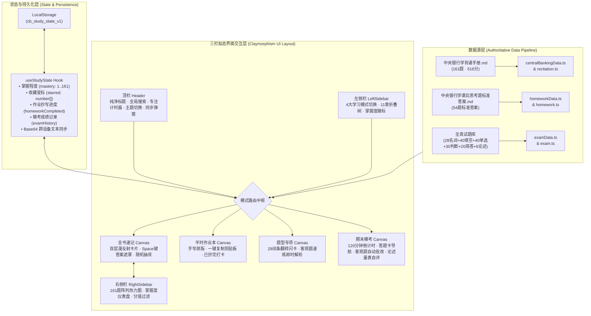

# 中央银行学 备考控制台 (Central Banking Study Console)

[](https://github.com/Coolzs77/central-banking-study-console)
[](https://coolzs77.github.io/central-banking-study-console/)
[](file:///e:/workspace/central-banking-study-console/package.json)
[](https://react.dev/)
[](https://vitejs.dev/)
[](https://tailwindcss.com/)
[](file:///e:/workspace/central-banking-study-console/LICENSE)

> **在线访问与随身刷题**：👉 [https://coolzs77.github.io/central-banking-study-console/](https://coolzs77.github.io/central-banking-study-console/)  
> **GitHub 源码仓库**：👉 [https://github.com/Coolzs77/central-banking-study-console](https://github.com/Coolzs77/central-banking-study-console)

中央银行学现代化备考复习系统，基于 Vite 6 + React 18 + TypeScript + Tailwind CSS 构建。界面全面复刻粘土拟态（Claymorphism）双层漫反射阴影系统与按压果冻回弹交互，专为高校期末冲刺与金融考研深度定制。

---

## 📊 数据体系全景

| 模块 | 数据规模 | 核心标准与采分规则 | 对应页面 |
| :--- | :--- | :--- | :--- |
| **全书背诵速记** | 161 题 · 516 分 | 覆盖全部 11 章与 40 个节，支持关键词多色高亮、空格键盲背遮罩与随机抽背 | [RecitationCanvas](file:///e:/workspace/central-banking-study-console/src/components/RecitationCanvas.tsx) |
| **平时作业本** | 54 题手写精练版 | 覆盖第 1 至 11 章思考题（分布为 6+6+3+6+5+5+5+4+2+5+7），支持一键复制与抄写打卡 | [HomeworkCanvas](file:///e:/workspace/central-banking-study-console/src/components/HomeworkCanvas.tsx) |
| **题型专项速练** | 28 词条 + 客观题 | 严选 28 个核心高频名词（≤30），规范 3 分答题法（定义 1.5 分 + 性质 1 分 + 职能 0.5 分） | [PracticeCanvas](file:///e:/workspace/central-banking-study-console/src/components/PracticeCanvas.tsx) |
| **期末模考真卷** | 100 分标准卷 | 120 分钟倒计时：名词 15 分 + 填空 15 分 + 单选 15 分 + 判断 15 分 + 简答 20 分 + 论述 20 分 | [MockExamCanvas](file:///e:/workspace/central-banking-study-console/src/components/MockExamCanvas.tsx) |

---

## 🏗️ 系统架构与数据流转



---

## ✨ 核心界面特性

1. **拟态阴影与果冻回弹 (Claymorphism System)**：
   - 核心阴影变量：`--clay-card-shadow`、`--clay-button-shadow`、`--clay-inset-groove`；
   - 弹性过渡：`--ease-spring: cubic-bezier(0.34, 1.56, 0.64, 1)`；
   - 触觉按压反馈：`.clay-squash:active { transform: scaleX(1.03) scaleY(0.95); }`。
2. **纯净无虚浮设计**：
   - 顶栏仅保留纯净标题“中央银行学”，杜绝营销套话与无意义标语；
   - 支持快捷键 `/` 快速聚焦搜索考点，支持实时高亮定位。
3. **沉浸式盲背遮罩**：
   - 全局与单题双重遮罩，轻按键盘**空格键 (Space)** 瞬间模糊隐藏参考答案，检验真实记忆效果。
4. **161题热力图直达定位**：
   - 右侧栏 161 个题号磁贴实时反馈绿（已吃透）、黄（需强化）、灰（未掌握）三态；
   - 点击任意题号磁贴，中栏平滑平移滚动并将目标考点卡片高亮框选 1.5 秒。
5. **100分全真模考自动化**：
   - 内置标准客观题自动判分引擎（单选、填空、判断改错一秒计分）；
   - 主观题严格配套三阶采分标准（名词解释定义1.5+性质1+职能0.5，论述题理论4+机制8+实践6+结论2）。

---

## 🚀 快速上手与验证

### 1. 启动开发服务器
```bash
cd e:\workspace\central-banking-study-console
npm run dev
```

### 2. 执行自动化验证套件 (59 项断言)
```bash
npm test
```

### 3. 生产打包构建
```bash
npm run build
```

---

## 📝 更新日志 (Changelog)

| 版本 | 发布日期 | 更新内容 | 状态 |
| :--- | :--- | :--- | :--- |
| **v1.0.0** | 2026-11-24 | 建立 Vite 6 + React 18 + TS + Tailwind 基础工程；完成 161 题背诵手册、54 题课后思考题与 100 分期末全真题库集成；完成粘土拟态三栏布局、Space遮罩盲背、120分钟期末模考与跨设备同步功能，59项自动化测试全部通过。 | 稳定可用 |
